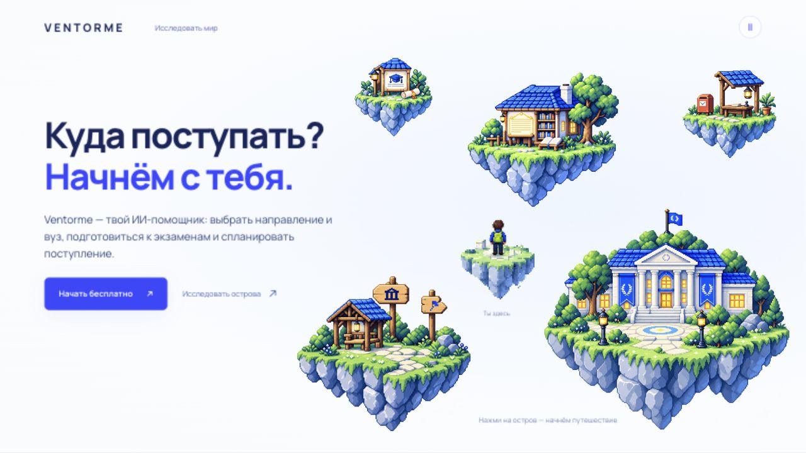

# Axiom (Ventorme)

Интерактивный пиксельный лендинг Ventorme для Hacknext. Пять тематических островов и маленький центральный остров с одним путешественником. Белый фон и сине-белая палитра.



## Запуск

Нужен Node.js 22.12 или новее.

```sh
npm ci
npm run dev -- --host 127.0.0.1 --port 4321
```

Открой http://127.0.0.1:4321/. Astro 7 запускает сервер в фоне:

```sh
npm run dev -- status
npm run dev -- logs
npm run dev -- stop
```

## Что работает

- Пиксельные острова с прежними зданиями из одобренного концепта; края и детали слегка доработаны: направление, университет, подготовка, финансирование, заявка.
- Один герой: приседание, отталкивание, полёт по дуге, приземление с восстановлением и ходьба.
- Камера приближает выбранный остров; иллюстрация карты плавно смешивается с детальной сценой. Общий белый фон и герой сохраняются в DOM.
- У каждого острова собственное здание: мастерская, университетский кампус, библиотека, павильон стипендий, приёмная.
- Внутри можно нажать на дорожку или на вход. Герой подходит к точке; у входа открывается описание и переход на платформу Ventorme.
- Возвращение отдаляет камеру и возвращает героя на центральный остров прыжком.
- Адаптивная композиция, клавиатурный выбор, системное уменьшение движения и ручной переключатель.
- Целые острова плавно парят на ±3 пикселя с разными периодами. Герой следует центральному островку. Во время прыжка и входа парение приостанавливается. Деревья и камни отдельно не двигаются, поэтому нет разрывов.

Это лендинг. Подбор вуза, тесты и регистрация продолжаются на официальной платформе; здесь эти функции не имитируются.

## Основные файлы

- `src/components/pixel/UnifiedLanding.tsx` — сцена, камера, последовательность прыжка и переходы.
- `src/components/pixel/HeroSprite.tsx` — воспроизведение 24 кадров персонажа.
- `src/components/pixel/worlds.ts` — содержание островов.
- `src/components/pixel/unified.css`, `pixel.css` — интерфейс и адаптивность.
- `public/map-islands/*-polished.png` — прозрачные спрайты карты с исправленными краями. Прежние SVG сохранены рядом.
- `public/islands/` — прозрачные детальные иллюстрации внутренних сцен.
- `public/characters/hero-atlas.png` — атлас персонажа: 6 столбцов × 4 ряда.
- `src/config/campaign.ts` — ссылка регистрации и атрибуция команды.

Происхождение изображений и спецификация генерации: [docs/pixel-assets.md](docs/pixel-assets.md). Компоненты прежних вариантов остаются в исходниках, но главная страница подключает только UnifiedLanding.

## Проверки

Перед сборкой останови dev-сервер, чтобы два процесса Vite не оптимизировали зависимости одновременно.

```sh
npm run dev -- stop
npm run build
npx --no-install tsc --noEmit
npm test
npm run check:release
```

Тесты проверяют логику рекомендаций, состояние, SSR и кампанию. Визуальные переходы дополнительно проверяются в браузере на компьютере и телефоне.

## Конкурсная ссылка

По умолчанию кнопки ведут на `https://ventorme.ai/register` без номера команды. Для конкурса нужен официальный номер:

```sh
PUBLIC_VENTORME_MODE=competition PUBLIC_VENTORME_TEAM_ID=YOUR_TEAM npm run build
PUBLIC_VENTORME_MODE=competition PUBLIC_VENTORME_TEAM_ID=YOUR_TEAM npm run check:release
```

Настройки есть в `.env.example`. Секреты и локальные `.env` в репозиторий не входят.

## Кадры для видеоперехода

[Промпт на 4 секунды](docs/transition-prompt.md). Чистые кадры можно снова получить через `/transition-frame?world=university&view=map` и `/transition-frame?world=university&view=inside`. Допустимые world: direction, university, preparation, funding, application. Страница предназначена для экспорта референсов без интерфейса; она не подключена к пользовательской навигации. Промпты доработки островов: [docs/map-polish-prompts.md](docs/map-polish-prompts.md).
